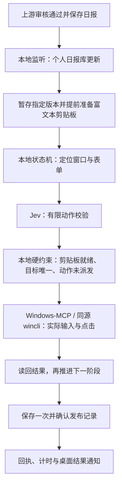

# Windows-MCP × Jev：桌面自动化提速实践

以钉钉日报为案例，将 Windows-MCP、Jev 有限动作判断、本地执行程序和更新监听组合，减少大模型反复观察与调用桌面工具的往返。

更新日期：2026-11-08。此仓库现已包含实际工作流源代码、模拟测试、配置样例及部署说明。个人日报、密钥、数据库、原始截图和运行记录不在上传范围内。代码需要对接自己的日报库及已安装的桌面工具，并非下载即用的软件包。

## 自动设定日报工作流

审核通过后的日报进入本地个人日报库 → 本地程序检测新版本 → 只读暂存指定版本 → 并行准备富文本剪贴板和调出钉钉 → 打开日志并核对模板 → 粘贴一次 → 滚动至定时区域 → 设置当天 23:30 → 保存一次 → 读回发布记录 → 桌面提示结果。

- 普通日期处理日报，使用“日报”模板的“今日完成工作”。
- 只有用户明确指定当天为周报日，才以周报替代日报发送；周报使用“周报”模板，“本周完成工作”和“下周工作计划”分栏粘贴。
- 当前代码保留周报长期自动发送的保护性阻断：两个栏目曾分阶段实测，但尚未完成稳定的无人干预整体验证。不要把模板分支已实现理解为周报已完全自动化。
- 复制现成排版，不审稿、不改写；沿用当前收件人、收件群和转发设置。
- 等待上传时仅在本地检查数据库文件变化，不调用模型；有效新事件进入流程后才请求 Jev。
- 每个上传版本只处理一次，同日已有成功排程则跳过；保存结果不明时停止，不重复保存。
- 监听跟随智能体服务启动和退出；进度条只在实际执行时显示，结束后给出一次结果提示。

2026-11-06 的一次日报实测从执行启动至确认保存耗时 **59.356 秒**，其中桌面执行约 59.031 秒。此数字不包含当天恢复暂停配置的人工排查时间；不能当成长期平均耗时。确认的是钉钉原生定时已保存，未验证最终投递。

开始使用请看 [部署与操作说明](docs/deployment.md)。源代码位于 [asphalt-daily/](asphalt-daily/)，导出差异见 [source-manifest.json](docs/source-manifest.json)。发布版只调整机器路径、移除历史事件回退及独立实验入口；没有改动当前电脑正在运行的安装。

## 当前限制

- 需要已解锁的 Windows 交互会话。锁屏截图能力不等于锁屏下可输入和点击。
- 模板切换目前依赖顶部直接显示的“日报／周报”入口；仅有“切换模板”下拉时停止。
- 周报分栏与定时开关仍有界面兼容性待完善，默认不开放长期自动周报。
- 本地数据库结构、原富文本渲染器及 wincli 二进制需自行提供；仓库不包含第三方二进制或私人业务数据库。
- Jev 网络错误、控件不唯一、时间已过或保存回执不明确时会停止，不承诺所有钉钉版本通用。

## 已验证的结果

一次实际完整执行：个人日报库更新 → 本地监听发现 → 准备富文本剪贴板 → 调出钉钉 → 日志表单 → 粘贴一次 → 滚动到底部 → 输入当天 23:30 → 保存 → 读回发布记录。

|指标|实测|
|---|---:|
|检测到新日报至执行结束|54.402 秒|
|日报库更新至执行结束|约 55.8 秒，源更新时间只有秒级精度|
|两次 Jev 判断合计|2.584 秒|
|桌面工具调用|37 次|
|其中界面快照|20 次，合计 46.813 秒|
|最终结果|已保存，页面显示“将于 2026-10-21 23:30 发布”|

这是**单次成功样本**，不是稳定性或长期平均值。准备剪贴板时命中了缓存。记录证明原生定时已保存，不证明之后已实际投递。

## 分工

- **本地程序**负责监听、状态、版本、剪贴板、动作顺序和去重。
- **Jev**接收简短状态，在预定义动作集合中判断。本次完整执行只调用两次：粘贴前、滚动前。
- **Windows-MCP / wincli**负责查窗口、读控件、点击、键盘输入、滚动和截图。
- **主模型**负责搭建、修复、分析异常，不在正常流程的每一步重新规划。

本案例的本地状态机已经知道每个阶段期望的动作，Jev 的返回结果必须与之匹配才能执行。因此它是阶段校验器，尚未证明它比纯确定性状态机更快或更可靠。

## 提速来自哪些改动

1. 从本地文件直接准备富文本，提前与窗口导航并行；不再用鼠标在智能体里复制。
2. 把“准备剪贴板”“粘贴一次”“滚动页面”分开，消除动作语义混淆。
3. 常规流程由本地程序连续执行，减少主模型逐步看图和调用工具的往返。
4. 只向 Jev 提交当前阶段需要的状态，不发送正文、联系人或整棵控件树。
5. 当前控件定位后选择有效通道：适合的控件用 UIA，已证实 UIA 点击无效的入口用当前坐标点击。
6. 用有限等待和读回确认推进，不因调用返回成功就假定页面已切换。

未做同条件的“仅增加 Jev”对照实验，不能把全部提速归因于 Jev，也不能用局部毫秒动作时间冒充完整流程时间。

## 仓库内容

- [工作流执行源码与模拟测试](asphalt-daily/)
- [部署与操作说明](docs/deployment.md)
- [代码导出来源及适配记录](docs/source-manifest.json)
- [架构与执行契约](docs/architecture.md)
- [实测数据与计时口径](docs/benchmarks.md)
- [踩坑、修复与待办](docs/lessons.md)
- [复现与迁移清单](docs/reproduction.md)
- [脱敏完整执行数据](data/real-run-summary.json)
- [72 次合成判断汇总](data/synthetic-decisions-summary.json)
- [有限动作定义示例](examples/decision-contract.json)

## 可迁移范围

适合迁移到页面结构相对稳定、动作集合有限、可以读回结果的表单、练习答题和桌面录入。题目理解和解题仍应由适合的模型完成；Jev 可用于判断“待选择、已选择、可下一题”等流程状态。每种业务都要重新接入和验证，日报测试结果不能直接当成其他业务的准确率。

## 技术来源

- Windows-MCP 上游：[sbroenne/mcp-windows](https://github.com/sbroenne/mcp-windows)。本地验证固定于 v1.3.28，提交 `655b9fc92d03ad52a270067c6844ea1231c90559`，使用同源构建的 wincli。
- Jev 使用官方 TypeSafe System One 接口，实测模型为 `jev-1.13.0`：[接口文档](https://docs.typesafe.ai/api/system-one)、[Choice 文档](https://docs.typesafe.ai/primitives/choice)。

上游项目、服务和本项目总结相互独立；本文报告本地观察，不承诺其他客户端版本或环境具有相同性能。
